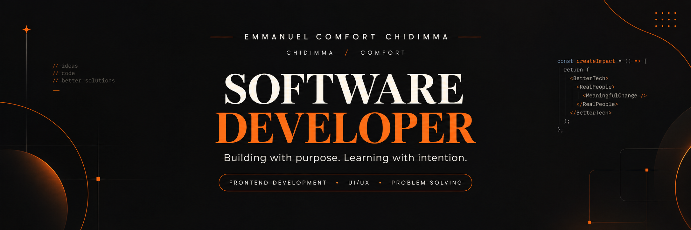

<p align="center">
  
</p>

# Emmanuel Comfort Chidimma | Personal Portfolio

<p align="center">
  
  
  
  
</p>

<p align="center">
  <strong>Code. Creativity. Continuous Growth.</strong>
</p>

<p align="center">
  A personal portfolio showcasing my journey, technical skills, projects, interests, and the ideas I'm bringing to life through technology.
</p>

---

## About Me

Hey! I'm **Emmanuel Comfort Chidimma**, a certified Software Developer and Information Technology student at Anchor University, Lagos, Nigeria.

I'm passionate about technology, creative problem-solving, and building digital experiences that combine functionality with thoughtful design.

My interests include frontend development, UI/UX, and creating practical solutions to real-world problems. I enjoy exploring new technologies, collaborating with other developers, and continuously improving my approach to software development.

This portfolio is a reflection of my journey, the things I've built, the skills I'm developing, and the developer I'm becoming.

**I believe in building with purpose, learning through experience, and making technology meaningful.**

## About This Project

This is my personal developer portfolio, designed to provide a central space where people can explore my work, learn more about me, discover my skills, and connect with me.

Built with React and Tailwind CSS, the portfolio combines a responsive interface with interactive elements and smooth animations to create an engaging browsing experience.

It is designed to evolve alongside my professional journey as I continue learning, experimenting, and building.

## Features

- **Personal Introduction:** A dedicated space to learn about me, my background, interests, and professional journey.
- **Project Showcase:** A collection of selected projects highlighting my development experience and problem-solving approach.
- **Skills & Services:** An overview of my technical interests, capabilities, and areas of development.
- **Interactive Navigation:** A structured navigation experience for exploring different sections.
- **Animated Intro Loader:** A custom introduction sequence featuring the letters S-K-O-L.
- **Motion & Interactions:** Smooth transitions and animations powered by Framer Motion.
- **Interactive Components:** Custom interface elements, including an avatar, chat interface, and interactive wheel.
- **Responsive Design:** An adaptable layout designed for desktop, tablet, and mobile screens.
- **Contact & Feedback:** Dedicated sections for communication and visitor feedback.

## Tech Stack

| Technology | Purpose |
|---|---|
| React | Component-based user interface |
| JavaScript | Application functionality |
| Tailwind CSS | Styling and responsive layouts |
| Framer Motion | Animations and transitions |
| Vite | Development environment and build tool |
| CSS | Custom styling and visual effects |

## Project Structure

```text
P-Port/
│
├── public/
│   ├── images/              # Profile and portfolio images
│   └── videos/              # Background video assets
│
├── src/
│   ├── components/          # Reusable UI components
│   │   ├── Wheel.jsx
│   │   ├── Avatar.jsx
│   │   ├── Navbar.jsx
│   │   ├── Chat.jsx
│   │   ├── Background.jsx
│   │   └── Loader.jsx
│   │
│   ├── data/
│   │   └── config.js        # Personal information and content
│   │
│   ├── pages/
│   │   ├── Home.jsx
│   │   ├── About.jsx
│   │   ├── Projects.jsx
│   │   ├── Services.jsx
│   │   ├── Contact.jsx
│   │   └── Feedback.jsx
│   │
│   └── styles/
│       └── index.css        # Global styles and theme
│
├── index.html
├── package.json
└── README.md
```

*Note: The structure above describes the main application areas; individual filenames may change as the project evolves.*

## Getting Started

Want to run the project locally? Follow these steps.

### Prerequisites

Make sure you have installed:

- [Node.js](https://nodejs.org/) (v18 or newer)
- npm (included with Node.js)
- Git

### Installation

**1. Clone the repository**

```bash
git clone https://github.com/Skol-Chie/P-Port.git
```

**2. Navigate into the project directory**

```bash
cd P-Port
```

**3. Install dependencies**

```bash
npm install
```

**4. Start the development server**

```bash
npm run dev
```

**5. Open the local address**

Visit the URL displayed in your terminal, usually:

```text
http://localhost:5173
```

### Production Build

To generate an optimized production build:

```bash
npm run build
```

To preview the production build locally:

```bash
npm run preview
```

The generated production files will be available in the `dist/` directory.

## Customization

The portfolio is structured to make personal updates straightforward.

- **Personal Information:** Update `src/data/config.js`.
- **Profile Images:** Add your images to `public/images/`.
- **Background Video:** Add your video to `public/videos/background.mp4`.
- **Projects:** Update your project information and links in the configuration file.
- **Styling:** Customize the global styles in `src/styles/index.css`.
- **Pages:** Modify individual page components inside `src/pages/`.

## What's Next?

This portfolio is an evolving project. As I grow as a developer, I intend to continue improving its functionality, refining the user experience, and showcasing more of the projects and solutions I create.

## Let's Connect

I'm always interested in connecting with developers, exploring opportunities, collaborating on meaningful projects, and learning from people in the tech community.

- **GitHub:** [@Skol-Chie](https://github.com/Skol-Chie)
- **LinkedIn:** [www.linkedin.com/in/comfort-emmanuel-03159032b]
- **Email:** [skolemmie@gmail.com]
-  **Substack:** [(https://substack.com/@emmanuelcomfortchidimma)]
- **Portfolio:** [Add your live portfolio URL]

---

<p align="center">
  Designed and developed with curiosity, creativity, and a love for technology.
</p>

<p align="center">
  <strong>Emmanuel Comfort Chidimma</strong><br/>
  Still learning. Still building. Always growing. 💜
</p>
